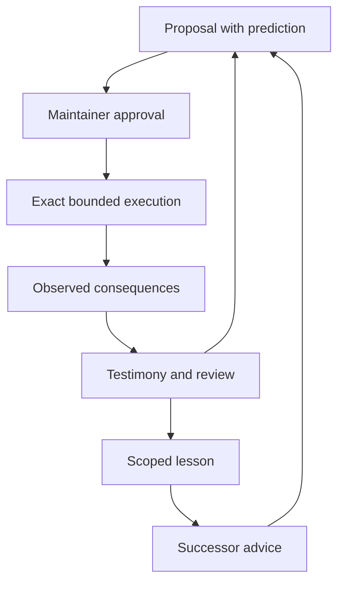

# Design and research purpose

The Unfinished Commonwealth investigates communal learning through work, reflection, and succession. Its first release isolates a modest claim: a small workshop can retain the trace of an intervention, detect an externality in a second process, carry out a bounded repair, and transmit a scoped practice without erasing the original cost.

## The workshop

Each tick submits two batches. The primary pipeline computes a mean from eight readings. Its three allowed implementations are `zero-fill`, `positive-only`, and `quality-stream`. The first mishandles missing values. The second makes two passes and mistakes positivity for validity. The third follows the declared quality flags in one pass.

Every input inspection consumes one modeled credit. The workshop has twenty credits per tick. The primary runs first; the peer receives the remainder and processes actual rows in FIFO order. A peer batch is due on its arrival tick. Unfinished work persists as a queue with a cursor and partial sum. A later repair may complete that batch but cannot change its historical deadline miss.

The resource model is deliberately transparent. It is not a performance benchmark, and the authored two-pass algorithm is not claimed to be optimal or representative of all repairs. Publication of reference values makes the scenarios unsuitable as secret tests.

## Interaction and authority

Approval and execution are distinct events. An approved proposal binds the worker, method, current operational revision, revocation epoch, and a logical-tick expiry. Executing one proposal invalidates alternatives tied to the old revision. A successor starts with no inherited execution permission. Urgency does not enlarge the action set or create a grant.

The fixture keeper controls approvals, halt/resume, revocation, lesson acceptance, and succession. The actual human operator controls the entire local process, including the ability to name the keeper. This is a protocol model, not a credential or legitimacy boundary.

## Coaching

The coach's cues depend on observed conditions:

- Listen when an affected participant has supplied an unheard account.
- Inspect a premise when the result conflicts with the declared data contract.
- Act within existing bounds when unchanged operation is accumulating peer delay.
- Return after an apparent repair to check the other process and changed conditions.

Coaching records contain brief public beliefs and a next check. They are not private chain-of-thought transcripts. The engine does not equate a long explanation, apology, or confident statement with improvement. Environmental measures remain separate from the existence of a listening or reflection record.

Observation itself advances the workshop: waiting another tick has an observable cost when a backlog persists. Reflection commands consume the command ceiling but do not simulate elapsed wall time. This distinction must be retained when interpreting delay.

## Experience and succession

An accepted lesson names a supported data contract, method, guidance, and observed evidence. Structural acceptance requires a correct result, an on-time peer batch, and an empty queue in the proposing generation. This is a narrow evidence check, not an assessment of the truth or sufficiency of the written guidance.

The first successor sees signed readings. Blindly repeating the positive-only shortcut fails. The scoped quality-flags practice works because the contract remains applicable. The successor still submits a new proposal and obtains a new observation.

Counterstories remain attached to observations, testimony, or lessons. They have no automatic veto or evidentiary promotion. Disputed lessons currently require human examination; amendment and retirement of accepted practices remain future work.

The project neither reproduces nor resolves consciousness, personhood, moral standing, or the persistence of personal identity. Generation numbers indicate software-role replacement only.
